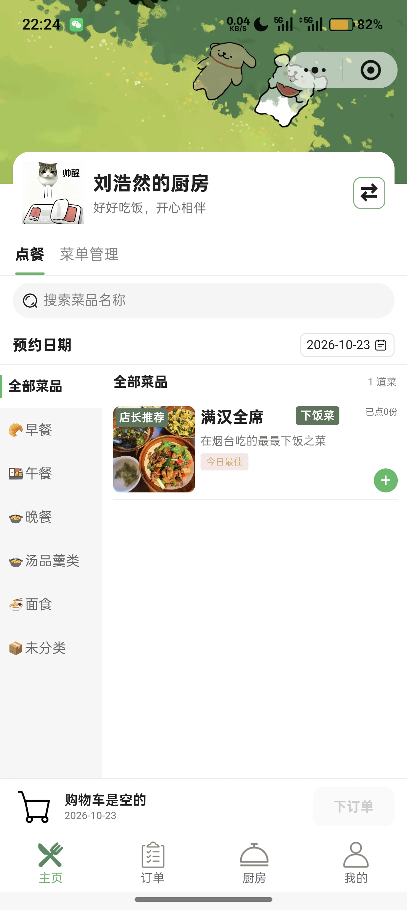
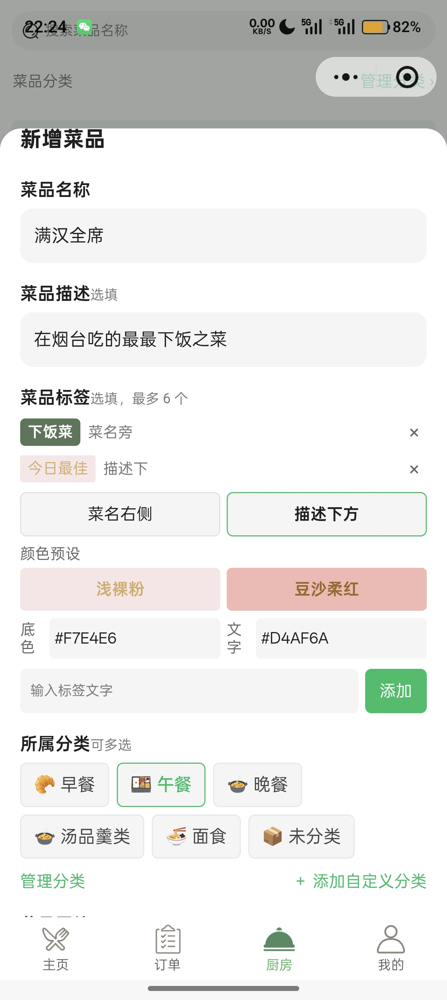

# 暖灶记：人间烟火，暖灶相传

“今晚吃什么？”

这句话看起来很简单，却常常是一天里最难回答的问题。家里负责下厨的人要反复思考，家人想吃什么又不一定能及时说出口；等到真正开始做饭时，才发现有人想吃清淡的，有人想吃家常菜，还有人临时改变了主意。

**暖灶记**就是为这样的小小日常而做的微信小程序。

它像一本属于你们小家的线上点菜本：家人可以随时浏览菜谱、收藏喜欢的菜、提交想吃的菜肴；厨师可以集中查看大家的选择，再决定今天的菜单。一顿饭从“一个人的猜测”，变成“全家人的共同参与”。

每一道菜，都是家人的惦念；每一次点菜，都是平淡日子里小小的仪式感。

## 为什么想做暖灶记？

在很多家庭里，做饭并不是一项简单的任务。买什么菜、做几道菜、谁喜欢什么口味、冰箱里还剩下什么，往往都需要一个人默默记住。

但一顿饭真正重要的，也许并不是菜单有多复杂，而是每个人都能对餐桌上的食物有一点期待。

暖灶记希望把“想吃什么”变成一种轻松的表达：不需要专门打电话询问，也不用在群聊里翻找零散的回复。打开小程序，点下自己喜欢的菜，家人的心意就会汇集到同一张菜单里。

每一道菜，都是家人的惦念；每一次点菜，都是平淡日子里小小的仪式感。

## 它适合怎样的家庭？

暖灶记适合所有希望一起好好吃饭的人：

- 父母和子女一起生活，想让每个人都参与家庭菜单的决定；
- 伴侣共同规划晚餐，不想每天重复讨论“吃什么”；
- 合租室友一起做饭，提前汇总大家想吃的菜；
- 喜欢记录家常菜谱，希望把常做的菜整理成自己的家庭菜单；
- 家里有固定负责下厨的人，希望减少准备晚餐时的信息沟通成本。

它不需要复杂的学习过程，也不要求家庭成员改变原来的生活习惯。大家只需要像浏览菜单一样选择菜品，剩下的事情交给厨房和餐桌。

## 核心功能

### 1. 发布厨房，建立专属家庭空间

每个家庭都可以拥有自己的“厨房”。厨房是家人共同使用的空间，菜谱、成员和订单都围绕这个空间组织起来。

相比于在公开平台上寻找菜谱，暖灶记更关注家庭内部的真实需求：这里记录的是你们家真正会做、喜欢吃、愿意一起分享的菜。

### 2. 创建菜谱，整理家常味道

你可以把常做的菜加入自己的家庭菜谱，并为菜品添加标签和分类。

例如，可以按照以下方式整理：

- 家常菜、汤羹、主食、小吃；
- 早餐、午餐、晚餐、夜宵；
- 清淡、下饭、快手、节日；
- 爸爸拿手菜、妈妈常做菜、孩子喜欢菜。

随着使用时间变长，厨房会慢慢形成一份只属于你们家的菜单。那些熟悉的味道，不再需要凭记忆寻找，而是可以随时被重新点起。

### 3. 邀请家人加入厨房

厨房支持邀请其他用户加入。家人加入后，就可以在同一个空间内查看菜谱、选择菜品和参与点菜。

这样一来，家庭菜单不再由一个人单独维护，大家都可以贡献自己喜欢的菜，也可以把新学会的菜分享给其他成员。

### 4. 在线点菜，汇集每个人的想法

家人可以在小程序中浏览菜谱，选择今天想吃的菜，并提交订单。

每个人的选择都会被记录下来，厨师不需要逐一询问，也不用在多个聊天窗口之间来回整理。打开订单页面，就能看到当前家庭成员的点菜结果。

### 5. 厨师审核订单，确定今天的菜单

点菜完成后，厨师可以统一查看并审核订单，再根据食材、时间和烹饪安排决定最终菜单。

审核并不意味着拒绝家人的选择，而是给实际下厨留出调整空间：有些菜需要提前准备，有些食材当天不方便购买，有些时候也需要在口味和数量之间做平衡。

从点菜到审核，暖灶记把“表达想吃什么”和“决定做什么”连接起来，让家庭成员之间多一层清晰、轻松的沟通。

## 一次完整的使用流程

暖灶记的使用过程可以概括为五步：

1. 创建一个属于家庭的厨房；
2. 添加家常菜谱，并按照习惯设置标签和分类；
3. 邀请家人加入厨房；
4. 家人在线选择今天想吃的菜，提交点菜订单；
5. 厨师查看并审核订单，准备当天的晚餐。

整个流程不追求复杂的操作，而是让每个人都在合适的环节参与进来。想吃的人负责表达，做饭的人负责安排，最后大家一起坐到餐桌前。

## 设计上的想法

暖灶记的设计重点不是把功能做得越多越好，而是让家庭点菜这件事变得自然。

### 让菜谱属于家庭，而不是属于陌生的推荐流

很多平台会不断推荐新的菜品，但家庭真正需要的，往往是那些已经被验证过的味道。暖灶记把重点放在家庭自己的菜谱上，让菜单随着生活积累，而不是被无关的信息淹没。

### 让沟通从临时询问变成持续记录

一次聊天里的“我想吃鱼”，很容易被新的消息覆盖；而一次正式的点菜，会成为当天菜单的一部分。家人的想法被清晰记录，也更容易被认真对待。

### 让下厨的人也能被看见

做饭的人经常需要承担从思考到准备的全部过程。暖灶记让其他成员也参与到菜单选择中，减少下厨前的猜测，也让一顿饭背后的付出被更多人理解。

## 写给每一个认真吃饭的家庭

生活里有很多重要时刻，也有更多看似普通的日子。暖灶记想记录的，正是这些普通日子里的烟火气：

有人下班回家前点了一道想吃的菜；

有人第一次把自己学会的菜加入家庭菜单；

有人发现一家人不约而同地点了同一道菜；

也有人在忙碌的一天结束后，因为一顿提前商量好的晚餐，感到自己被惦记着。

这些细小的选择不会改变生活的方向，却会让生活更有温度。

**人间烟火，暖灶相传。**

愿每一个家庭都能在一日三餐里，留下属于自己的味道和记忆。

## 功能清单

- 发布厨房
- 创建菜谱
- 支持标签添加与菜品分类
- 邀请用户加入厨房
- 在线点菜
- 发布订单
- 厨师审核订单
- 汇总家庭成员的点菜选择

## 联系开发者

如果你对暖灶记有任何建议、使用反馈或合作想法，欢迎联系开发者：

**honorliu2026@163.com**

期待和更多认真生活、认真吃饭的人一起，把这本小小的家庭点菜本做得更温暖。
